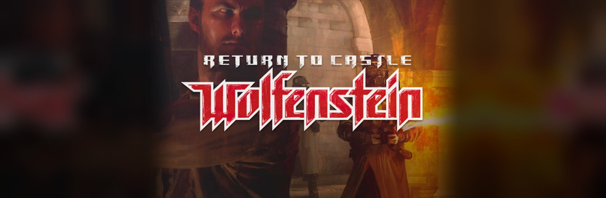

<div align="center">



# RtCWNX

**Return to Castle Wolfenstein on Nintendo Switch**

Unofficial Nintendo Switch port of **Return to Castle Wolfenstein** (2001), single player
and multiplayer, built on the [iortcw](https://github.com/iortcw/iortcw) source port,
with a native [deko3D](https://github.com/devkitPro/deko3d) renderer.

[](#)
[](#)
[](docs/architecture.md)
[](#)
[](LICENSE)

</div>

---

> [!WARNING]
> Work in progress: both games start on a console, and their picture is being fixed. The whole
> game has run on a PC, on real game files, with a stand-in for the console. See [Status](#status).

This repository has no game files. You need your own copy of the game.

## What you need

- A Switch with Atmosphère and a homebrew menu (hbmenu or
  [sphaira](https://github.com/ITotalJustice/sphaira))
- Your own PC copy of **Return to Castle Wolfenstein**, with its last patch (GOG's and
  Steam's copies already have it)
- About 770 MB free on the SD card

## Installing

1. Copy `RtCWNX.nro` to `sd:/switch/RtCWNX/`, and `RtCWNX_MP.nro` to `sd:/switch/RtCWNX/mp/`.
2. Copy the game's `.pk3` files from its `Main` folder to `sd:/switch/RtCWNX/main/`, or let a
   script do it and check them:

   ```bash
   python tools/package_sd.py "/path/to/your/copy/of/Return to Castle Wolfenstein"
   ```

   That fills `SD_CARD/`: copy what is inside it to the root of the card.
3. Start **Return to Castle Wolfenstein** from the homebrew menu. For the full memory, start the
   homebrew menu through a game's title override, not from the album. From the album the game
   lowers its texture quality to fit.

The **Multiplayer** entry of the game's menu starts the multiplayer game, and its **Single Player**
entry comes back.

## Controls

| Switch | Game |
| --- | --- |
| Left stick | Move, with analog speed |
| Right stick | Look |
| ZR | Fire |
| ZL | Binoculars |
| L / R | Lean left / right |
| A | Jump |
| B | Crouch |
| X | Reload |
| Y | Use, open, pick up |
| Left stick click | Sprint |
| Right stick click | Kick (single player), drop the weapon (multiplayer) |
| D-pad right | Tap: next weapon. Hold: **weapon wheel**, the right stick picks |
| D-pad left | Previous weapon |
| D-pad up | The weapon's other mode: scope, silencer |
| D-pad down | Throw a grenade (single player), quick chat (multiplayer) |
| − | Notebook (single player), scores (multiplayer) |
| + | Menu, skip a video |
| + and − together | Console |

In menus, the sticks or the touch screen move the pointer, the D-pad moves from entry to entry,
**A** chooses, **B** goes back, **X** opens the system keyboard for a text field, **Y** erases and
**L** / **R** scroll lists. With the console down, **A** opens the keyboard for a command.

Every button can be changed in the game's **Controls** menu. Prompts in the game use the names
`BUTTON_A`, `BUTTON_ZR`, `DPAD_UP`, `STICK_L` and so on. The console has `in_nxDeadZone`,
`in_nxInvertLook`, `sensitivity` (the look's speed) and `r_gamma` (the menu's brightness).

## Logs

The game writes to `sd:/switch/RtCWNX/SD_LOG/`:

| File | What it is |
| --- | --- |
| `rtcw_log.txt` | everything the game printed (`rtcw_log_previous.txt` is the last run) |
| `rtcw_crash.txt` | a crash: the address, the call stack, the registers |
| `rtcw_fatal.txt` | a fatal error's message |

The multiplayer game writes `rtcw_mp_*.txt`. Open an issue with them to report a problem. For a live
log, start the game with `nxlink -s RtCWNX.nro`. `sd:/switch/RtCWNX/args.txt`, if you create it, holds
command line arguments, like `+set r_dkPerf 1`.

## Status

| Area | State |
| --- | --- |
| Builds: both games, native renderer, shaders | Works, here and on GitHub Actions |
| Game files, file system, all 32 campaign maps | Works on a PC, with a stand-in for the GPU |
| Menus, HUD, videos, fog, lean, weapon wheel, save and load | Works on a PC, the same way |
| Multiplayer, local server | Works on a PC, the same way |
| Boots on a console: both games | Works, with no errors in the logs |
| The picture through deko3D | **Distorted in the first test: fix waiting for a second test** |
| Sound, Joy-Cons | **Not confirmed yet** |
| Online play against PC servers | **Not tested yet** |
| 60 fps at 1020/460/1331 MHz | **Not measured yet** |

What was checked and how is in [docs/status.md](docs/status.md).

## Building

GitHub Actions builds every push: the `RtCWNX_sd` artifact is the SD card layout. Locally, with
[devkitPro](https://devkitpro.org/wiki/Getting_Started), from its MSYS2 shell or the
`devkitpro/devkita64` container:

```bash
dkp-pacman -S switch-dev switch-cmake deko3d uam switch-libjpeg-turbo switch-zlib
./build.sh
```

This puts the NROs in `SD_CARD/`. How the port is put together is in
[docs/architecture.md](docs/architecture.md), and how to test it in [docs/testing.md](docs/testing.md).
[tools/hostcheck](tools/hostcheck/README.md) runs the port on a PC.

## Credits

- [iortcw](https://github.com/iortcw/iortcw) and its contributors: the source port this is built on
- id Software, Gray Matter Interactive and Nerve Software: the game and its released source code
- [fincs](https://github.com/fincs) and the devkitPro team: devkitA64, libnx, deko3D and uam

## Disclaimer

Return to Castle Wolfenstein is a trademark of its respective owners. This project is not affiliated
with, endorsed or sponsored by them. It contains no game data. The icon and the banner show the
game's art, to identify the game.

## License

GPL-3.0 with id Software's additional terms, like iortcw: see [LICENSE](LICENSE) and the notes in the
source files.
